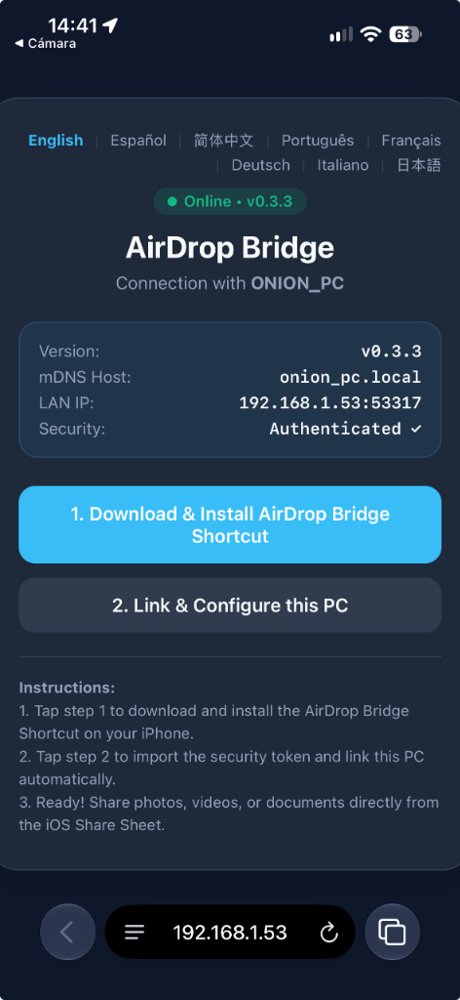

<p align="center">
  
</p>

<h1 align="center">AirDrop Bridge</h1>

<p align="center">
  <strong>Native, blazing-fast file transfers from iPhone and iPad to Windows and Linux.</strong><br>
  No third-party iOS apps, no cloud accounts, and no subscriptions.
</p>

<p align="center">
  <strong>English</strong> |
  <a href="docs/translations/README.es.md">Español</a> |
  <a href="docs/translations/README.zh.md">简体中文</a> |
  <a href="docs/translations/README.pt.md">Português</a> |
  <a href="docs/translations/README.fr.md">Français</a> |
  <a href="docs/translations/README.de.md">Deutsch</a> |
  <a href="docs/translations/README.it.md">Italiano</a> |
  <a href="docs/translations/README.ja.md">日本語</a>
</p>

<p align="center">
  <a href="https://github.com/jorjanion/airdrop-bridge/releases"></a>
  <a href="https://github.com/jorjanion/airdrop-bridge/blob/main/LICENSE"></a>
  
  
  
</p>

> ⭐ **Love AirDrop Bridge?** Please consider giving it a star on GitHub! It helps more people discover this free, open-source project and motivates ongoing development.

---

## Overview

**AirDrop Bridge** lets you send photos, 4K videos, and documents from your iPhone or iPad directly to your computer using your local Wi-Fi network.

Instead of requiring an App Store download or sending your personal files through third-party cloud servers, AirDrop Bridge pairs your PC directly with an official Apple Shortcut. It integrates seamlessly into the native iOS Share Sheet, Action Button, and Back Tap gesture.

<p align="center">
  
  &nbsp;&nbsp;&nbsp;&nbsp;
  
  &nbsp;&nbsp;&nbsp;&nbsp;
  
</p>

---

## Key Features

* **100% Local & Private**: Direct peer-to-peer Wi-Fi streaming. Your photos and files never leave your home network.
* **Zero Third-Party Apps on iOS**: Uses an official Apple Shortcut signed by iOS.
* **Blazing Fast**: Uses chunked disk streaming with constant memory usage (under 15 MB RAM on PC). Transfer gigabyte-sized videos without buffering or RAM spikes.
* **Zero-Config Discovery**: Automatic local detection via mDNS and LAN fallback.
* **Secure by Default**: Cryptographic Bearer token authorization blocks unwanted transfers on shared Wi-Fi networks.
* **Global Language Support**: Full interface translation in 8 languages (English, Español, 简体中文, Português, Français, Deutsch, Italiano, and 日本語).
* **Native Desktop Experience**: Windows dark-mode pairing window, system tray menu, customizable audio chimes, and interactive toast notifications.
* **Clipboard Synchronization**: Send copied text between devices with a single tap.
* **Automatic Updates**: Silent background updater keeps you on the latest version.

<p align="center">
  
</p>

---

## Quick Start Guide

Setting up AirDrop Bridge takes less than a minute.

### 1. Download & Launch on PC
* Download `airdrop-bridge-windows-x64.exe` from the latest [GitHub Releases](https://github.com/jorjanion/airdrop-bridge/releases/latest).
* Double-click to start. AirDrop Bridge runs silently in your system tray and opens the pairing window with a QR code.

### 2. Scan with your iPhone Camera
* Open the default Camera app on your iPhone or iPad and scan the QR code on your PC screen.
* Tap the yellow link to open the setup portal in Safari.

### 3. Install the Official Apple Shortcut
* On the web page, tap **"1. Download & Install AirDrop Bridge Shortcut"**.
* Safari will ask to open Apple Shortcuts. Tap **Open** and then tap **Add Shortcut**.

### 4. Link your PC
* Return to Safari and tap **"2. Link & Configure this PC"**.
* The shortcut will import your secure security token and local IP address automatically.

### 5. Start Sharing Files & Clipboard!

#### Sending Photos, Videos & Files:
* Open the **Photos** or **Files** app on your iPhone.
* Select any photo, video, or document, tap the **Share** button, and choose **AirDrop Bridge**.
* Your file will arrive instantly in your PC Downloads folder (`Downloads\AirDropBridge`), accompanied by a chime and a desktop notification!

#### Syncing Clipboard (Bidirectional):
* Run the **AirDrop Bridge** shortcut directly (from the Shortcuts app, Home Screen, Action Button, or Back Tap).
* A menu will prompt you with two options:
  * 📤 **Send clipboard**: Sends whatever text you have copied on your iPhone straight to your PC clipboard.
  * 📥 **Get clipboard**: Pulls the text currently on your PC clipboard directly into your iPhone.
* You can also select any text on your iPhone (in Safari, Notes, or Messages), tap **Share**, and pick **AirDrop Bridge** to copy it instantly to your PC!

---

## Windows SmartScreen Notice

When running AirDrop Bridge for the first time, Windows Defender SmartScreen may display a blue dialog:

> *"Windows protected your PC"*

### Why does this appear?
Commercial code-signing certificates from Microsoft partners cost hundreds of dollars every year. Because AirDrop Bridge is an independent, non-commercial open-source project, we do not purchase costly enterprise certificates. Windows temporarily shows this warning on newer executable downloads until enough users have run them.

### How to proceed:
1. Click on **"More info"**.
2. Click **"Run anyway"**.

The full application source code is 100% open, transparent, and auditable right here in this repository. You can also build it directly from source with Cargo if you prefer!

---

## System Tray Settings

Right-click the AirDrop Bridge icon in the Windows taskbar tray to access quick settings:

* **Open AirDrop Bridge**: Show the QR pairing window at any time.
* **Open Downloads**: Quick shortcut to your received files folder.
* **Copy Token**: Copy your security token to the clipboard.
* **Settings**:
  * **Start with Windows**: Toggle automatic startup on login.
  * **System Notifications**: Enable or mute desktop toast notifications.
  * **Sound on Receive**: Play a subtle audio chime when a file arrives.
  * **Open Folder on Receive**: Automatically pop open the destination folder.
  * **Sync Clipboard**: Keep clipboard synchronization active.
  * **Automatic Updates**: Check and update silently in the background.
  * **Language**: Switch instantly between English, Spanish, Chinese, Portuguese, French, German, Italian, or Japanese.

---

## Building from Source

Requirements: [Rust](https://www.rust-lang.org/) (2024 edition or newer).

```bash
git clone https://github.com/jorjanion/airdrop-bridge.git
cd airdrop-bridge
cargo build --release
```

The optimized executable will be generated at `target/release/airdrop-bridge.exe`.

---

## Contributing, Issues & PRs

We welcome contributions, bug reports, and suggestions from the community!

### Reporting Bugs or Requesting Features
If you run into an issue or have an idea to improve AirDrop Bridge:
1. Visit the [Issues Tracker](https://github.com/jorjanion/airdrop-bridge/issues).
2. Check if a similar issue has already been reported.
3. Click **New Issue** and describe:
   * What happened and what you expected to happen.
   * Your operating system version (e.g. Windows 11, Windows 10, or Linux distribution).
   * Your iOS/iPadOS version (e.g. iOS 18.1).
   * Steps to reproduce the issue.

### Submitting a Pull Request (PR)
1. Fork the repository and create a descriptive feature branch:
   ```bash
   git checkout -b feature/my-cool-improvement
   ```
2. Make your changes cleanly and ensure all tests pass:
   ```bash
   cargo test
   ```
3. Commit your changes following standard commit conventions (e.g. `feat: ...`, `fix: ...`).
4. Push to your fork and open a Pull Request against the `main` branch.
5. Provide a brief summary of what your PR introduces. We review and merge PRs actively!

---

## License

AirDrop Bridge is licensed under either of:

* Apache License, Version 2.0 ([LICENSE-APACHE](LICENSE) or http://www.apache.org/licenses/LICENSE-2.0)
* MIT license ([LICENSE-MIT](LICENSE) or http://opensource.org/licenses/MIT)

at your option.
