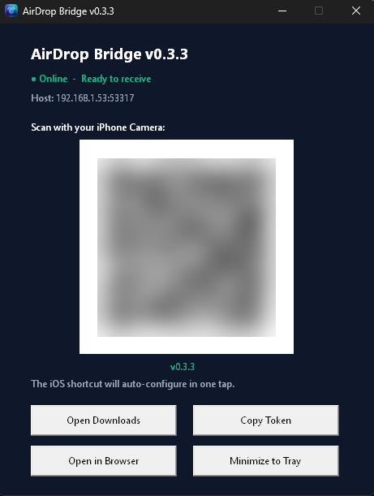

<p align="center">
  
</p>

<h1 align="center">Drop Bridge</h1>

<p align="center">
  <strong>Native, blitzschnelle Dateiübertragungen von iPhone und iPad auf Windows und Linux.</strong><br>
  Keine Drittanbieter-Apps auf iOS, keine Cloud-Konten und keine Abonnements.
</p>

<p align="center">
  <a href="../../README.md">English</a> |
  <a href="README.es.md">Español</a> |
  <a href="README.zh.md">简体中文</a> |
  <a href="README.pt.md">Português</a> |
  <a href="README.fr.md">Français</a> |
  <strong>Deutsch</strong> |
  <a href="README.it.md">Italiano</a> |
  <a href="README.ja.md">日本語</a>
</p>

<p align="center">
  <a href="https://github.com/jorjanion/DropBridge/releases"></a>
  <a href="https://github.com/jorjanion/DropBridge/blob/main/LICENSE"></a>
  
  
  
</p>

> ⭐ **Gefällt dir Drop Bridge?** Bitte gib dem Projekt einen Stern auf GitHub! Das hilft anderen, dieses kostenlose Open-Source-Projekt zu entdecken, und motiviert uns bei der Weiterentwicklung.

---

## Übersicht

**Drop Bridge** ermöglicht es dir, Fotos, 4K-Videos und Dokumente von deinem iPhone oder iPad über dein lokales WLAN-Netzwerk direkt auf deinen Computer zu übertragen.

Anstatt auf Drittanbieter-Apps aus dem App Store angewiesen zu sein oder persönliche Dateien über fremde Cloud-Server zu leiten, verbindet Drop Bridge deinen PC direkt mit einem offiziellen Apple-Kurzbefehl. Dieser integriert sich nahtlos in das native Teilen-Menü von iOS, die Aktionstaste oder das Tippen auf die Geräterückseite.

<p align="center">
  
  &nbsp;&nbsp;&nbsp;&nbsp;
  
  &nbsp;&nbsp;&nbsp;&nbsp;
  
</p>

---

## Hauptfunktionen

* **100% Lokal und Privat**: Direkte Punkt-zu-Punkt-Übertragung über WLAN. Deine Dateien verlassen zu keinem Zeitpunkt dein Heimnetzwerk.
* **Keine Drittanbieter-Apps unter iOS**: Nutzt einen offiziellen, vom iOS-System signierten Apple-Kurzbefehl.
* **Maximale Geschwindigkeit**: Direktes Streaming auf den Datenträger bei konstant geringer Speichernutzung (unter 15 MB RAM auf dem PC). Übertrage riesige Videos ohne Speicherengpässe.
* **Konfigurationsfreie Erkennung**: Automatische Erkennung im lokalen Netzwerk per mDNS mit LAN-IP-Fallback.
* **Sicher ab Werk**: Kryptografische Bearer-Token-Autorisierung verhindert unbefugte Übertragungen in öffentlichen Netzwerken.
* **Unterstützung für 8 Sprachen**: Vollständige Lokalisierung in English, Español, 简体中文, Português, Français, Deutsch, Italiano und 日本語.
* **Native Desktop-Erfahrung**: Dunkles Kopplungsfenster, Systemleisten-Symbol, dezenter Benachrichtigungston und interaktive Windows-Benachrichtigungen.
* **Zwischenablage-Synchronisation**: Kopierten Text mit nur einem Fingertipp zwischen den Geräten teilen.
* **Automatische Updates**: Unaufdringlicher Hintergrundprüfer hält die Anwendung immer auf dem aktuellen Stand.

<p align="center">
  
</p>

---

## Schnellstartanleitung

Die Einrichtung ist in weniger als einer Minute abgeschlossen.

### 1. Auf dem PC herunterladen und starten
* Lade `drop-bridge-windows-x64.exe` von den [GitHub Releases](https://github.com/jorjanion/DropBridge/releases/latest) herunter.
* Mit einem Doppelklick starten. Die Anwendung läuft dezent im Infobereich und öffnet das Kopplungsfenster mit dem QR-Code.

### 2. Mit der iPhone-Kamera scannen
* Öffne die Kamera-App auf deinem iPhone oder iPad und richte sie auf den QR-Code auf deinem Bildschirm.
* Tippe auf den angezeigten gelben Link, um das Einrichtungsportal in Safari zu öffnen.

### 3. Den offiziellen Apple-Kurzbefehl installieren
* Tippe auf der Webseite auf **"1. Drop Bridge Kurzbefehl herunterladen & installieren"**.
* Safari fragt nach dem Öffnen in Kurzbefehle. Tippe auf **Öffnen** und anschließend auf **Kurzbefehl hinzufügen**.

### 4. Den PC koppeln
* Kehre zu Safari zurück und tippe auf **"2. Diesen PC koppeln & konfigurieren"**.
* Der Kurzbefehl übernimmt automatisch dein Sicherheitstoken und die IP-Adresse deines PCs.

### 5. Bereit zum Teilen von Dateien und Zwischenablage!

#### Fotos, Videos und Dateien senden:
* Öffne die **Fotos**- oder **Dateien**-App auf deinem iPhone.
* Wähle Fotos, Videos oder Dokumente aus, tippe auf **Teilen** und wähle **Drop Bridge**.
* Deine Datei landet sofort in deinem Downloads-Ordner (`Downloads\DropBridge`), begleitet von einem Hinweiston und einer Desktop-Benachrichtigung!

#### Zwischenablage synchronisieren (bidirektional):
* Führe den Kurzbefehl **Drop Bridge** direkt aus (über die Kurzbefehle-App, ein Startbildschirm-Widget, die Aktionstaste oder Tippen auf die Rückseite).
* Ein Auswahldialog bietet zwei praktische Aktionen:
  * 📤 **Send clipboard**: Überträgt den auf dem iPhone kopierten Text direkt in die Zwischenablage deines PCs.
  * 📥 **Get clipboard**: Holt den aktuell auf dem PC kopierten Text direkt auf dein iPhone.
* Du kannst auch beliebigen Text auf deinem iPhone markieren (in Safari, Notizen oder Nachrichten), auf **Teilen** tippen und **Drop Bridge** wählen, um ihn sofort an den PC zu senden!

---

## Hinweis zu Windows SmartScreen

Beim ersten Start von Drop Bridge zeigt Windows Defender SmartScreen möglicherweise ein blaues Hinweisfenster an:

> *"Der Computer wurde durch Windows geschützt"*

### Warum erscheint dieser Hinweis?
Kommerzielle Codesignatur-Zertifikate von Microsoft-Partnern kosten jährlich Hunderte von Euro. Als unabhängiges, kostenloses Open-Source-Projekt erwerben wir keine kostspieligen Unternehmenszertifikate. Windows zeigt diesen Schutzhinweis vorübergehend bei neuen ausführbaren Dateien an, bis genügend Downloads verzeichnet wurden.

### So fährst du sicher fort:
1. Klicke auf **"Weitere Informationen"**.
2. Klicke auf die Schaltfläche **"Trotzdem ausführen"**.

Der gesamte Quellcode ist zu 100% öffentlich, transparent und direkt in diesem Repository einsehbar. Falls gewünscht, kannst du das Projekt auch selbst mit Cargo aus dem Quellcode kompilieren!

---

## Einstellungen im Infobereich

Klicke mit der rechten Maustaste auf das Drop Bridge-Symbol in der Taskleiste, um auf die Optionen zuzugreifen:

* **Drop Bridge öffnen**: Zeigt das QR-Kopplungsfenster jederzeit wieder an.
* **Downloads öffnen**: Direkter Zugriff auf den Ordner mit den empfangenen Dateien.
* **Token kopieren**: Kopiert das Sicherheitstoken in die Zwischenablage.
* **Einstellungen**:
  * **Mit Windows starten**: Autostart bei der Windows-Anmeldung aktivieren oder deaktivieren.
  * **Systembenachrichtigungen**: Desktop-Meldungen anzeigen oder stummschalten.
  * **Ton beim Empfangen**: Dezenten Ton abspielen, sobald eine Datei ankommt.
  * **Ordner beim Empfangen öffnen**: Zielordner nach Abschluss automatisch öffnen.
  * **Zwischenablage synchronisieren**: Textaustausch aktiv halten.
  * **Automatische Updates**: Neue Versionen im Hintergrund prüfen und einspielen.
  * **Sprache**: Sofort zwischen den 8 verfügbaren Sprachen wechseln.

---

## Aus dem Quellcode erstellen

Voraussetzungen: [Rust](https://www.rust-lang.org/) (Edition 2024 oder neuer).

```bash
git clone https://github.com/jorjanion/DropBridge.git
cd DropBridge
cargo build --release
```

Die optimierte Binärdatei befindet sich unter `target/release/drop-bridge.exe`.

---

## Mitwirken, Fehlerberichte (Issues) und PRs

Beiträge, Fehlermeldungen und Vorschläge aus der Community sind jederzeit herzlich willkommen!

### Fehler melden oder Wünsche äußern
Falls du auf ein Problem stößt oder eine Verbesserung vorschlagen möchtest:
1. Besuche den [Issue Tracker auf GitHub](https://github.com/jorjanion/DropBridge/issues).
2. Prüfe, ob das Thema bereits existiert.
3. Klicke auf **New Issue** und gib an:
   * Was passiert ist und was du erwartet hast.
   * Deine Betriebssystemversion (z.B. Windows 11 oder Linux-Distribution).
   * Deine iOS/iPadOS-Version (z.B. iOS 18.1).
   * Nachvollziehbare Schritte zur Reproduktion des Problems.

### Einen Pull Request (PR) einreichen
1. Forke das Repository und erstelle einen Arbeitszweig:
   ```bash
   git checkout -b feature/meine-verbesserung
   ```
2. Nimm deine Änderungen vor und stelle sicher, dass alle Tests erfolgreich sind:
   ```bash
   cargo test
   ```
3. Verfasse deine Commits nach den üblichen Konventionen (z.B. `feat: ...`, `fix: ...`).
4. Pushe auf deinen Fork und erstelle einen Pull Request gegen den `main`-Branch.
5. Beschreibe kurz den Zweck deiner Anpassungen. Wir freuen uns über jeden Beitrag!

---

## Lizenz

Drop Bridge ist nach deiner Wahl unter einer der folgenden Lizenzen verfügbar:

* Apache License, Version 2.0 ([LICENSE-APACHE](../../LICENSE) oder http://www.apache.org/licenses/LICENSE-2.0)
* MIT license ([LICENSE-MIT](../../LICENSE) oder http://opensource.org/licenses/MIT)
