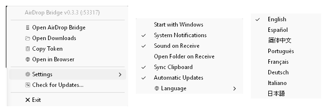

<p align="center">
  
</p>

<h1 align="center">AirDrop Bridge</h1>

<p align="center">
  <strong>Transferts de fichiers natifs et ultrarapides depuis iPhone et iPad vers Windows et Linux.</strong><br>
  Aucune application tierce sur iOS, aucun compte cloud et aucun abonnement.
</p>

<p align="center">
  <a href="../../README.md">English</a> |
  <a href="README.es.md">Español</a> |
  <a href="README.zh.md">简体中文</a> |
  <a href="README.pt.md">Português</a> |
  <strong>Français</strong> |
  <a href="README.de.md">Deutsch</a> |
  <a href="README.it.md">Italiano</a> |
  <a href="README.ja.md">日本語</a>
</p>

<p align="center">
  <a href="https://github.com/jorjanion/airdrop-bridge/releases"></a>
  <a href="https://github.com/jorjanion/airdrop-bridge/blob/main/LICENSE"></a>
  
  
  
</p>

> ⭐ **Vous appréciez AirDrop Bridge ?** N'hésitez pas à lui donner une étoile sur GitHub ! Cela aide le projet à se faire connaître et nous motive à continuer son développement.

---

## Présentation

**AirDrop Bridge** vous permet d'envoyer des photos, des vidéos 4K et des documents depuis votre iPhone ou iPad directement vers votre ordinateur via votre réseau Wi-Fi local.

Au lieu d'imposer des applications lourdes de l'App Store ou de faire transiter vos fichiers privés par des serveurs cloud tiers, AirDrop Bridge associe votre PC à un raccourci Apple officiel. Il s'intègre naturellement à la feuille de partage d'iOS, au bouton Action ou au toucher à l'arrière.

<p align="center">
  
  &nbsp;&nbsp;&nbsp;&nbsp;
  
  &nbsp;&nbsp;&nbsp;&nbsp;
  
</p>

---

## Fonctionnalités principales

* **100% Local et Privé**: Transfert direct en point à point par Wi-Fi. Vos fichiers ne quittent jamais votre réseau domestique.
* **Aucune application tierce sur iOS**: Fonctionne grâce à un raccourci Apple officiel signé par iOS.
* **Performances maximales**: Écriture directe par flux sur disque sans saturation de la mémoire (moins de 15 Mo de RAM sur le PC). Transférez des vidéos volumineuses sans ralentissement.
* **Découverte automatique**: Détection instantanée sur le réseau local via mDNS avec secours par IP LAN.
* **Sécurité par défaut**: Authentification par jeton Bearer cryptographique pour empêcher tout transfert non désiré sur les réseaux publics.
* **Prise en charge de 8 langues**: Interface entièrement traduite en English, Español, 简体中文, Português, Français, Deutsch, Italiano et 日本語.
* **Expérience de bureau soignée**: Fenêtre de jumelage en mode sombre, icône dans la zone de notification, signal sonore discret et notifications Windows.
* **Synchronisation du presse-papiers**: Envoyez des textes copiés d'un appareil à l'autre en un geste.
* **Mises à jour automatiques**: Système discret en arrière-plan pour disposer en continu de la dernière version.

<p align="center">
  
</p>

---

## Guide de démarrage rapide

La configuration s'effectue en moins d'une minute.

### 1. Télécharger et lancer sur PC
* Téléchargez `airdrop-bridge-windows-x64.exe` depuis la page des [Releases GitHub](https://github.com/jorjanion/airdrop-bridge/releases/latest).
* Double-cliquez pour démarrer. L'application se loge discrètement dans la zone de notification et ouvre la fenêtre avec le QR code.

### 2. Scanner avec l'Appareil photo de l'iPhone
* Ouvrez l'application Appareil photo sur votre iPhone ou iPad et visez le QR code affiché à l'écran.
* Touchez le lien jaune qui s'affiche pour ouvrir la page d'accueil dans Safari.

### 3. Installer le Raccourci Apple officiel
* Sur la page web, touchez **"1. Télécharger et Installer le Raccourci AirDrop Bridge"**.
* Safari vous demandera d'ouvrir l'application Raccourcis. Touchez **Ouvrir**, puis **Ajouter ce raccourci**.

### 4. Associer le PC
* Revenez dans Safari et touchez **"2. Associer et Configurer ce PC"**.
* Le raccourci enregistrera automatiquement votre jeton de sécurité ainsi que l'adresse IP de votre ordinateur.

### 5. Partagez sans attendre !
* Ouvrez l'application **Photos** ou **Fichiers** sur votre iPhone.
* Sélectionnez des photos, vidéos ou documents, touchez le bouton **Partager** et choisissez **AirDrop Bridge**.
* Votre fichier arrive instantanément dans votre dossier Téléchargements (`Téléchargements\AirDropBridge`), accompagné d'un signal sonore et d'une notification de bureau !

---

## Notification Windows SmartScreen

Lors du premier lancement d'AirDrop Bridge, Windows Defender SmartScreen peut afficher une fenêtre bleue préventive :

> *"Windows a protégé votre ordinateur"*

### Pourquoi ce message s'affiche-t-il ?
Les certificats professionnels de signature de code de Microsoft coûtent plusieurs centaines d'euros chaque année. En tant que projet indépendant, gratuit et open source, nous ne souscrivons pas à ces certificats commerciaux. Windows affiche temporairement cet avertissement sur les nouveaux exécutables jusqu'à ce qu'un nombre suffisant de téléchargements soit enregistré.

### Comment poursuivre :
1. Cliquez sur **"Informations complémentaires"**.
2. Cliquez sur le bouton **"Exécuter quand même"**.

L'intégralité du code source est 100% ouverte, transparente et vérifiable directement sur ce dépôt. Vous pouvez également compiler le projet vous-même avec Cargo si vous le souhaitez !

---

## Paramètres de la zone de notification

Faites un clic droit sur l'icône AirDrop Bridge dans la barre des tâches pour accéder aux fonctions :

* **Ouvrir AirDrop Bridge**: Réaffiche la fenêtre de jumelage avec le QR code.
* **Ouvrir les Téléchargements**: Accès direct au dossier où sont enregistrés vos fichiers.
* **Copier le Jeton**: Copie votre jeton de sécurité dans le presse-papiers.
* **Paramètres**:
  * **Lancer avec Windows**: Active ou désactive le démarrage automatique à l'ouverture de session.
  * **Notifications Système**: Affiche ou masque les notifications de bureau.
  * **Son à la Réception**: Émet un signal sonore discret à l'arrivée d'un fichier.
  * **Ouvrir le Dossier à la Réception**: Ouvre automatiquement le dossier à la fin du transfert.
  * **Synchroniser le Presse-papiers**: Maintient active la synchronisation de texte.
  * **Mises à Jour Automatiques**: Recherche et applique les nouvelles versions en arrière-plan.
  * **Langue**: Bascule instantanément entre les 8 langues disponibles.

---

## Compilation depuis les sources

Prérequis : [Rust](https://www.rust-lang.org/) (édition 2024 ou plus récente).

```bash
git clone https://github.com/jorjanion/airdrop-bridge.git
cd airdrop-bridge
cargo build --release
```

L'exécutable optimisé sera généré dans `target/release/airdrop-bridge.exe`.

---

## Contributions, Problèmes (Issues) et PRs

Les contributions, signalements de bugs et suggestions de la communauté sont toujours les bienvenus !

### Signaler un problème ou suggérer une idée
Si vous rencontrez un comportement inattendu :
1. Consultez la page des [Issues GitHub](https://github.com/jorjanion/airdrop-bridge/issues).
2. Vérifiez si le sujet n'a pas déjà été abordé.
3. Cliquez sur **New Issue** et précisez :
   * Ce qui s'est produit et ce que vous attendiez.
   * Votre version de système d'exploitation (ex. Windows 11 ou distribution Linux).
   * Votre version d'iOS/iPadOS (ex. iOS 18.1).
   * Les étapes pour reproduire le problème.

### Proposer une Pull Request (PR)
1. Forkez le dépôt et créez une branche de travail dédiée :
   ```bash
   git checkout -b feature/ma-fonctionnalite
   ```
2. Appliquez vos modifications et vérifiez que les tests réussissent :
   ```bash
   cargo test
   ```
3. Rédigez vos commits selon les conventions habituelles (ex. `feat: ...`, `fix: ...`).
4. Poussez sur votre fork et ouvrez une Pull Request vers la branche `main`.
5. Décrivez succinctement votre proposition. Nous examinons et fusionnons les PRs avec plaisir !

---

## Licence

AirDrop Bridge est distribué sous l'une des licences suivantes, au choix de l'utilisateur :

* Licence Apache, Version 2.0 ([LICENSE-APACHE](../../LICENSE) ou http://www.apache.org/licenses/LICENSE-2.0)
* Licence MIT ([LICENSE-MIT](../../LICENSE) ou http://opensource.org/licenses/MIT)
