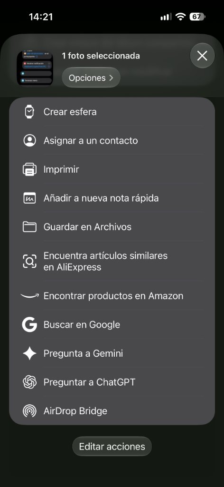

<p align="center">
  
</p>

<h1 align="center">AirDrop Bridge</h1>

<p align="center">
  <strong>iPhone や iPad から Windows や Linux へ、高速でシームレスなファイル送信を実現。</strong><br>
  iOS に外部アプリのインストールは不要、クラウド連携なし、完全無料で利用できます。
</p>

<p align="center">
  <a href="../../README.md">English</a> |
  <a href="README.es.md">Español</a> |
  <a href="README.zh.md">简体中文</a> |
  <a href="README.pt.md">Português</a> |
  <a href="README.fr.md">Français</a> |
  <a href="README.de.md">Deutsch</a> |
  <a href="README.it.md">Italiano</a> |
  <strong>日本語</strong>
</p>

<p align="center">
  <a href="https://github.com/jorjanion/airdrop-bridge/releases"></a>
  <a href="https://github.com/jorjanion/airdrop-bridge/blob/main/LICENSE"></a>
  
  
  
</p>

> ⭐ **AirDrop Bridge を気に入っていただけましたか？** ぜひ GitHub でスターをつけて応援してください！より多くの人にこの無料のオープンソースを知ってもらい、今後の開発の大きな励みになります。

---

## 概要

**AirDrop Bridge** は、お使いの iPhone や iPad から、写真や 4K 動画、書類などを自宅のローカル Wi-Fi ネットワーク経由でパソコンへ瞬時に送信できるツールです。

App Store から外部アプリをダウンロードしたり、大切な個人ファイルをサードパーティのクラウドサーバーに送る必要はありません。AirDrop Bridge は PC と Apple 公式ショートカットを直接連携させ、iOS の標準「共有」シート、アクションボタン、背面タップから直接使用できます。

<p align="center">
  
  &nbsp;&nbsp;&nbsp;&nbsp;
  
  &nbsp;&nbsp;&nbsp;&nbsp;
  
</p>

---

## 主な機能

* **100% ローカル＆プライベート**: Wi-Fi を介した直接 P2P 送信。ファイルや写真が外部ネットワークに出ることはありません。
* **iOS 側に追加アプリ不要**: Apple 公式の署名済みショートカットを利用するため安心です。
* **圧倒的な高速転送**: メモリを圧迫しないチャンク単位のディスク直接書き込み（PC 常駐メモリは 15 MB 未満）。ギガバイト級の長時間の高画質動画も快適に転送できます。
* **設定不要の自動検出**: mDNS による即時検出と、IP アドレス直接連携のデュアル対応。
* **高いセキュリティ**: 暗号化された Bearer トークン認証により、公共の Wi-Fi 環境でも不正な転送を防ぎます。
* **8 言語に完全対応**: English、Español、简体中文、Português、Français、Deutsch、Italiano、日本語に対応。
* **ネイティブな使い心地**: ダークモード対応の連携画面、タスクトレイメニュー、通知チャイム音、Windows トースト通知。
* **クリップボード同期**: ワンタップでコピーしたテキストをデバイス間で相互に送信可能。
* **バックグラウンド自動更新**: 面倒な手動更新不要で、常に最新バージョンを維持できます。

<p align="center">
  
</p>

---

## クイックスタートガイド

セットアップは 1 分もかからずに完了します。

### 1. PC へのダウンロードと起動
* [GitHub Releases](https://github.com/jorjanion/airdrop-bridge/releases/latest) から `airdrop-bridge-windows-x64.exe` をダウンロードします。
* ダブルクリックして起動します。タスクトレイに常駐し、画面上に QR コード付きの連携ウィンドウが表示されます。

### 2. iPhone のカメラでスキャン
* iPhone または iPad の標準「カメラ」アプリを開き、PC 画面の QR コードを読み取ります。
* 画面に表示される黄色のリンクをタップして、Safari で設定ページを開きます。

### 3. Apple 公式ショートカットの追加
* ページ内の **「1. AirDrop Bridge ショートカットをダウンロード＆インストール」** をタップします。
* 「ショートカットで開きますか？」と尋ねられたら **開く** をタップし、**ショートカットを追加** を選択します。

### 4. PC との連携
* Safari の画面に戻り、**「2. このPCと連携・設定する」** をタップします。
* セキュリティトークンと PC の IP アドレスが自動的にショートカットへ登録されます。

### 5. 準備完了！すぐに送信できます
* iPhone の **「写真」** や **「ファイル」** アプリを開きます。
* 共有したい写真や動画を選択し、**共有** ボタンから **AirDrop Bridge** を選択します。
* 即座に PC のダウンロードフォルダ（`Downloads\AirDropBridge`）へ届き、通知音とトースト通知でお知らせします！

---

## Windows SmartScreen の警告について

AirDrop Bridge を初めて起動した際、Windows Defender SmartScreen の青いダイアログが表示されることがあります：

> *"Windows によって PC が保護されました"*

### なぜこの警告が出るのですか？
Microsoft の商用コード署名証明書は年間で数十万円の費用が発生します。AirDrop Bridge は非営利のオープンソースプロジェクトであるため、高額な有償証明書を購入していません。そのため、新しい実行ファイルに対しては一定のダウンロード数が蓄積されるまで警告が表示されます。

### 続行の手順：
1. ダイアログ内の **「詳細情報」** をクリックします。
2. 表示される **「実行」** ボタンをクリックします。

すべてのソースコードは本リポジトリ上で 100% 公開されており、自由に監査できます。安心のために Cargo を使ってご自身でソースからビルドすることも可能です！

---

## タスクトレイメニューの機能

Windows タスクバー右下の通知領域にあるアイコンを右クリックすると、以下の操作が行えます：

* **AirDrop Bridge を開く**: QR コード画面をいつでも再表示できます。
* **ダウンロードを開く**: 受信ファイルが保存されるフォルダを素早く開きます。
* **トークンをコピー**: セキュリティトークンをクリップボードにコピーします。
* **設定**:
  * **Windows 起動時に実行**: PC 起動時の自動実行を切り替えます。
  * **システム通知**: デスクトップ通知の表示・非表示を設定します。
  * **受信時にサウンド再生**: ファイル到着時にチャイム音を鳴らします。
  * **受信時にフォルダを開く**: 受信完了後に自動でフォルダを開きます。
  * **クリップボード同期**: テキスト同期の有効・無効を切り替えます。
  * **自動アップデート**: バックグラウンドでの更新確認を行います。
  * **言語**: いつでも 8 つの対応言語を切り替えられます。

---

## ソースコードからのビルド

必要環境: [Rust](https://www.rust-lang.org/) (2024 edition 以降)。

```bash
git clone https://github.com/jorjanion/airdrop-bridge.git
cd airdrop-bridge
cargo build --release
```

最適化された実行ファイルは `target/release/airdrop-bridge.exe` に生成されます。

---

## 開発への参加・Issue と PR について

バグ報告、機能提案、プルリクエストなど、コミュニティからの貢献を歓迎しています！

### 問題の報告や機能リクエスト
不具合を見つけた場合や、改善案がある場合：
1. [GitHub の Issues ページ](https://github.com/jorjanion/airdrop-bridge/issues) を開きます。
2. 同様の問題が既に報告されていないか確認します。
3. **New Issue** をクリックし、以下を記載してください：
   * 発生した現象と期待される動作。
   * ご利用の OS バージョン（例: Windows 11 や Linux ディストリビューション）。
   * iOS / iPadOS のバージョン（例: iOS 18.1）。
   * 問題の再現手順。

### プルリクエスト（PR）の送信
1. リポジトリをフォークし、作業ブランチを作成します：
   ```bash
   git checkout -b feature/my-cool-feature
   ```
2. 変更を加え、すべてのテストが通ることを確認します：
   ```bash
   cargo test
   ```
3. 標準的なコミット規約に沿ってコミットを作成します（例: `feat: ...`, `fix: ...`）。
4. ご自身のフォークへプッシュし、`main` ブランチに対して Pull Request を作成します。
5. 変更内容を分かりやすく記載してください。迅速に確認・マージさせていただきます！

---

## ライセンス

AirDrop Bridge は以下のいずれかのライセンスのもとで利用可能です：

* Apache License, Version 2.0 ([LICENSE-APACHE](../../LICENSE) または http://www.apache.org/licenses/LICENSE-2.0)
* MIT license ([LICENSE-MIT](../../LICENSE) または http://opensource.org/licenses/MIT)
