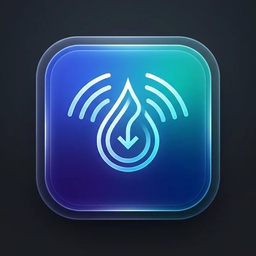

<p align="center">
  
</p>

<h1 align="center">Drop Bridge</h1>

<p align="center">
  <strong>Transferências nativas e ultrarrápidas do iPhone e iPad para Windows e Linux.</strong><br>
  Sem apps de terceiros no iOS, sem contas na nuvem e sem assinaturas.
</p>

<p align="center">
  <a href="../../README.md">English</a> |
  <a href="README.es.md">Español</a> |
  <a href="README.zh.md">简体中文</a> |
  <strong>Português</strong> |
  <a href="README.fr.md">Français</a> |
  <a href="README.de.md">Deutsch</a> |
  <a href="README.it.md">Italiano</a> |
  <a href="README.ja.md">日本語</a>
</p>

<p align="center">
  <a href="https://github.com/jorjanion/DropBridge/releases"></a>
  <a href="https://github.com/jorjanion/DropBridge/blob/main/LICENSE"></a>
  
  
  
</p>

> ⭐ **Gostou do Drop Bridge?** Deixe uma estrela no GitHub! Isso ajuda mais pessoas a descobrirem este projeto gratuito de código aberto e nos incentiva a continuar melhorando.

---

## Visão Geral

O **Drop Bridge** permite enviar fotos, vídeos em 4K e documentos do seu iPhone ou iPad diretamente para o seu computador usando a rede Wi-Fi local.

Em vez de exigir downloads na App Store ou enviar seus arquivos pessoais para servidores na nuvem de terceiros, o Drop Bridge conecta seu PC diretamente a um Atalho oficial da Apple. Ele se integra nativamente ao menu Compartilhar do iOS, ao Botão de Ação e ao toque na parte de trás.

<p align="center">
  
  &nbsp;&nbsp;&nbsp;&nbsp;
  
  &nbsp;&nbsp;&nbsp;&nbsp;
  
</p>

---

## Recursos Principais

* **100% Local e Privado**: Transferência direta ponto a ponto por Wi-Fi. Suas fotos e arquivos nunca saem da sua rede doméstica.
* **Zero apps de terceiros no iOS**: Utiliza um Atalho oficial assinado pelo sistema iOS.
* **Velocidade máxima**: Transmissão por blocos diretamente para o disco com uso constante de memória (menos de 15 MB de RAM no PC). Transfira vídeos pesados sem travamentos.
* **Descoberta sem configuração**: Detecção automática na rede local via mDNS e alternativa por IP LAN.
* **Segurança por padrão**: Autorização por token Bearer criptográfico que bloqueia transferências indesejadas em redes Wi-Fi públicas.
* **Suporte a 8 idiomas**: Interface traduzida para English, Español, 简体中文, Português, Français, Deutsch, Italiano e 日本語.
* **Experiência nativa no desktop**: Janela escura de pareamento, ícone na bandeja do sistema, aviso sonoro sutil e notificações toast no Windows.
* **Sincronização de área de transferência**: Envie textos copiados entre dispositivos com apenas um toque.
* **Atualizações automáticas**: Atualizador em segundo plano para manter você sempre na versão mais recente.

<p align="center">
  
</p>

---

## Guia de Início Rápido

Configurar o Drop Bridge leva menos de um minuto.

### 1. Baixar e iniciar no PC
* Baixe `drop-bridge-windows-x64.exe` na página de [Releases do GitHub](https://github.com/jorjanion/DropBridge/releases/latest).
* Dê um duplo clique para abrir. O programa rodará silenciosamente na bandeja do sistema e exibirá a janela com o código QR.

### 2. Escanear com a Câmera do iPhone
* Abra o app Câmera no seu iPhone ou iPad e aponte para o código QR na tela do computador.
* Toque no link amarelo para abrir a página de boas-vindas no Safari.

### 3. Instalar o Atalho oficial da Apple
* Na página web, toque em **"1. Baixar e Instalar Atalho Drop Bridge"**.
* O Safari perguntará se deseja abrir no Atalhos. Toque em **Abrir** e depois em **Adicionar Atalho**.

### 4. Vincular o PC
* Retorne ao Safari e toque em **"2. Vincular e Configurar este PC"**.
* O atalho importará automaticamente o seu token de segurança e o endereço IP do seu PC.

### 5. Pronto para compartilhar arquivos e área de transferência!

#### Enviando Fotos, Vídeos e Arquivos:
* Abra o app **Fotos** ou **Arquivos** no seu iPhone.
* Selecione fotos, vídeos ou documentos, toque no botão **Compartilhar** e selecione **Drop Bridge**.
* O arquivo chegará imediatamente na sua pasta Downloads (`Downloads\DropBridge`) com um aviso sonoro e notificação na tela!

#### Sincronizando Área de Transferência (Bidirecional):
* Execute o atalho **Drop Bridge** diretamente (pelo app Atalhos, widget na tela de início, Botão de Ação ou toque atrás).
* Um menu rápido aparecerá com duas opções:
  * 📤 **Send clipboard**: Envia o texto copiado no seu iPhone direto para a área de transferência do seu PC.
  * 📥 **Get clipboard**: Puxa o texto atual da área de transferência do seu PC diretamente para o seu iPhone.
* Você também pode selecionar qualquer texto no seu iPhone (no Safari, Notas ou Mensagens), tocar em **Compartilhar** e escolher **Drop Bridge** para enviá-lo ao PC instantaneamente!

---

## Aviso do Windows SmartScreen

Ao abrir o Drop Bridge pela primeira vez, o Windows Defender SmartScreen pode exibir uma caixa de diálogo azul:

> *"O Windows protegeu o seu computador"*

### Por que isso acontece?
Certificados de assinatura de código comerciais da Microsoft custam centenas de dólares por ano. Por ser um projeto independente e de código aberto, não compramos esses certificados empresariais. O Windows exibe esse aviso temporário em executáveis novos até que alcancem um número suficiente de downloads.

### Como continuar:
1. Clique em **"Mais informações"**.
2. Clique no botão **"Executar assim mesmo"**.

O código-fonte completo é 100% aberto e auditável neste repositório. Você também pode compilar o projeto diretamente com o Cargo se desejar!

---

## Configurações na Bandeja do Sistema

Clique com o botão direito no ícone do Drop Bridge na barra de tarefas para acessar as opções:

* **Abrir Drop Bridge**: Exibe a janela de pareamento com código QR a qualquer momento.
* **Abrir Downloads**: Acesso direto à pasta onde os arquivos são salvos.
* **Copiar Token**: Copia o token de segurança para a área de transferência.
* **Configurações**:
  * **Iniciar com o Windows**: Ativa ou desativa a inicialização automática no login.
  * **Notificações do Sistema**: Exibe ou oculta notificações na área de trabalho.
  * **Som ao Receber**: Toca um som suave na chegada de arquivos.
  * **Abrir Pasta ao Receber**: Abre a pasta de destino automaticamente ao receber.
  * **Sincronizar Área de Transferência**: Mantém a sincronização de texto ativa.
  * **Atualizações Automáticas**: Procura e instala novas versões silenciosamente.
  * **Idioma**: Alterne instantaneamente entre os 8 idiomas disponíveis.

---

## Compilação a partir do Código-Fonte

Requisitos: [Rust](https://www.rust-lang.org/) (edição 2024 ou superior).

```bash
git clone https://github.com/jorjanion/DropBridge.git
cd DropBridge
cargo build --release
```

O arquivo executável otimizado estará em `target/release/drop-bridge.exe`.

---

## Contribuições, Problemas (Issues) e PRs

Contribuições, relatos de bugs e sugestões da comunidade são sempre bem-vindos!

### Relatando Problemas ou Sugestões
Se encontrar algum erro ou tiver uma ideia de melhoria:
1. Visite o [Rastreador de Issues](https://github.com/jorjanion/DropBridge/issues).
2. Verifique se o assunto já foi discutido.
3. Clique em **New Issue** e informe:
   * O que aconteceu e o que era esperado.
   * Versão do seu sistema operacional (ex: Windows 11 ou distribuição Linux).
   * Versão do iOS/iPadOS (ex: iOS 18.1).
   * Passos detalhados para reproduzir o problema.

### Enviando um Pull Request (PR)
1. Faça um fork do repositório e crie um branch específico:
   ```bash
   git checkout -b feature/minha-melhoria
   ```
2. Realize suas modificações e confirme que os testes passam:
   ```bash
   cargo test
   ```
3. Salve seus commits usando o formato de commits convencionais (ex: `feat: ...`, `fix: ...`).
4. Envie para o seu fork e abra um Pull Request para a branch `main`.
5. Explique resumidamente a melhoria enviada. Revisamos e aceitamos melhorias com frequência!

---

## Licença

O Drop Bridge está disponível sob os termos de qualquer uma das licenças abaixo, a seu critério:

* Apache License, Versão 2.0 ([LICENSE-APACHE](../../LICENSE) ou http://www.apache.org/licenses/LICENSE-2.0)
* MIT license ([LICENSE-MIT](../../LICENSE) ou http://opensource.org/licenses/MIT)
